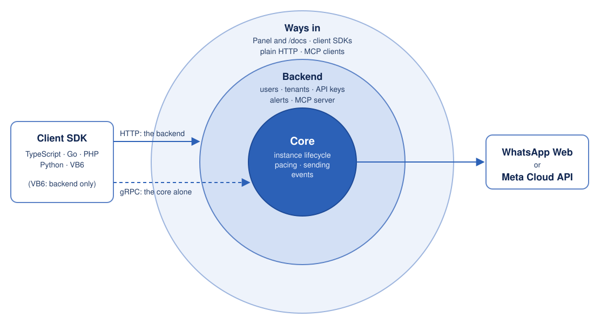
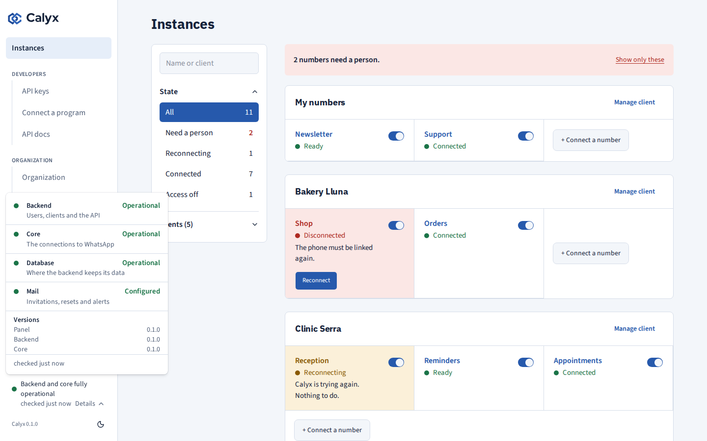

<div align="center">


# Calyx API

**A self-hosted engine to connect WhatsApp numbers to your software, with guardrails against spam
built into its foundation.**


**SDKs:**


-Windows%207%20SP1%2B%20%C2%B7%20backend-5C2D91)

**Connections:**


[](https://buymeacoffee.com/csmarckitus)

</div>

> [!NOTE]
> **The name.** In botany, the calyx is the ring of sepals that protects a flower while it is a
> bud. Calyx wants to be that protective layer around a WhatsApp number: its pacing and its guard
> against duplicate sends keep the number away from the patterns that look like spam. Nobody likes
> spam, and it is against the policies of WhatsApp and Meta, and against ours too.

> [!WARNING]
> WhatsApp Web support uses an unofficial client. Using it is against WhatsApp's Terms of Service,
> and WhatsApp can ban the number. The pacing rules of Calyx lower that risk; nothing removes it.
> The Meta Cloud API provider is the official way.

> [!IMPORTANT]
> Calyx is not a tool for spam. It enforces minimum delays and human-like pacing in the core,
> and **NO OPTION DISABLES THEM.**

**Status: version 0.1.0, alpha.** Every part works and has its tests, and I checked the core, the
backend and the panel by hand. The API can still change before version 1.0, but I will try to
keep it as it is, and I do not expect big changes.

## Contents

- [Where Calyx comes from](#where-calyx-comes-from)
- [Why Calyx exists](#why-calyx-exists)
- [What Calyx gives you](#what-calyx-gives-you)
- [The layers](#the-layers)
- [Installation](#installation)
- [Update to the latest version](#update-to-the-latest-version)
- [Connect your software](#connect-your-software)
- [Types of instance](#types-of-instance)
- [Real multi-tenancy](#real-multi-tenancy)
- [Calyx and Evolution API](#calyx-and-evolution-api)
- [Support Calyx](#support-calyx)
- [Contributing](#contributing)
- [License](#license)

## Where Calyx comes from

**Engineered, not improvised.** Calyx comes from a real need, and the need is old. In late 2021 (yes, before AI assistants were a thing), I tried a first solution with Playwright: a browser with one WhatsApp Web session open for each number. Calyx itself started quietly in March 2026 as a WhatsApp core written by hand in TypeScript. Later I moved the core to Go ([why Go](#why-go)). It grew slowly, in my free time, over months of work. Every feature starts with a written design that is reviewed before the code. The code is written test-first, and I check every change.

## Why Calyx exists

Calyx is for a responsible use of WhatsApp Web, mainly by individuals and by small and medium
companies.

What they want sounds simple: send a reminder to a customer on WhatsApp, as they already do by
mail. For mail, you connect the SMTP server of your provider, and it works. Nobody asks you for a
verification, you keep your normal mail app, and the provider keeps your messages.

With the official WhatsApp API, the same small task becomes a project:

- 🧩 Meta asks for a developer account, an app and, to send more, a business verification. The
  steps change often.
- 📱 A number on the official API leaves the WhatsApp app and the WhatsApp Business app. You must
  find your own way to store the messages and manage the templates, so most companies pay a
  Business Solution Provider (BSP) or install a tool such as Chatwoot. Meta has a "coexistence"
  mode that keeps the Business app, but only in some countries and with limits.
- 💸 Many small companies have no budget, no IT team and no servers for this integration.
- 🔌 Their software has no integration with any API, and they cannot write code.

Calyx connects the number through WhatsApp Web, as a linked device. The phone keeps working as
before, and WhatsApp keeps the history of the chats.

The official Meta Cloud API is also available in Calyx. **It should be the way for medium and
large companies**: those with an IT team, or with many sends every day.

> **Meta Cloud API:** works for replies. Message templates (needed to start a conversation, for
> example a reminder) are planned.

The rules against spam live in the core, so no client can turn them off.

## What Calyx gives you

> [!TIP]
> **🔔 Calyx tells you when a number disconnects.** The backend sends a mail when a number
> disconnects, so nobody finds out days later that the reminders did not go out.

<table>
<tr>
<td width="50%" valign="top">

✅ **One API, official or not.** Your program sends in the same way through WhatsApp Web or through the official Meta Cloud API.

✅ **A number that behaves like a person.** Every message waits its turn in one queue per number, with minimum delays and "typing...". This lowers the risk of a ban, and no program can skip it.

✅ **No reminder arrives two times.** When your program repeats a send after an error, with the same idempotency key, Calyx sends the message only once. It also refuses the same text to the same person within 10 minutes.

✅ **Pair a number in seconds.** The QR code and the status change appear live, in the panel or in your program. No reload and no polling.

✅ **Each event goes where you need it.** For example, the messages go to your CRM and the disconnections go to your monitoring. Each event can have its own URL and signing secret.

</td>
<td width="50%" valign="top">

✅ **Many numbers, little memory.** A send-only number sleeps when it has no work, and wakes up by itself when you send. No connection stays open all the time.

✅ **It keeps working.** Bulk jobs continue after a restart, webhooks can wait in a queue with retries, and a stop finishes the work in progress first.

✅ **Serve your clients for free.** Your clients connect and manage their own numbers, isolated from each other, in the open source edition.

✅ **Install only what you use.** Run the core alone from your own backend. Add the backend and the panel when you need users and tenants.

✅ **Your data stays with you.** Calyx runs on your server, and the backend stores no message content.

</td>
</tr>
</table>

## The layers

<p align="center">
  
</p>

Each ring works without the rings outside it, and does not pay for features it does not use. A
core client calls the core over gRPC, with no backend.

> [!IMPORTANT]
> **A change in WhatsApp touches only the core.** whatsmeow and the Meta Cloud API live only in the
> core, behind the gRPC contract. When WhatsApp changes, only the core changes. While the gRPC
> contract stays the same, the backend, the users, the API keys, the alerts, the panel and the
> SDKs keep working with no change.

| Layer | What it does | For whom | Status |
|---|---|---|---|
| **Core** (`apps/core`) | Manages the lifecycle of each number ("instance"): creates it, pairs it, connects it and removes it. Sends with pacing, runs bulk jobs, delivers events by webhook and gRPC stream. No users, no tenants. | Developers with their own backend | ✅ Built and tested |
| **Backend** (`apps/backend`) | HTTP API on top of the core: users, organizations and clients, isolation, API keys, quotas, mail alerts, MCP server, HTTPS with Traefik. | A company, or an agency that manages numbers for its clients | ✅ Built and tested |
| **Frontend** (`apps/frontend`) | Web UI for the backend: login, clients, instances, pairing, webhooks, API keys and bulk jobs, and the API reference at `/docs`. Runs with no domain in the compose profile `local`. | Everybody who prefers a UI | ✅ Built and tested |
| **Client SDK** (`packages/client-sdk`) | The [official SDKs](#official-sdks): TypeScript, Go, PHP and Python (backend and core), and VB6 (backend only). | Developers | ✅ Built and tested; VB6 tested on Windows |

### The panel

<p align="center">
  
</p>

The numbers of each client, with their state. The filter on the left counts the numbers in each
state and shows one state at a time. The health card shows that the backend, the core, the
database and the mail work.
The screenshot uses example data.

### Why gRPC in the core

- ✅ **A typed contract.** The `.proto` files are the public API (`calyx.core.v1`). Generate a
  client for Go, TypeScript, Python, Java, C# and many more languages.
- ✅ **Streams.** Pairing codes, QR codes and incoming events arrive as a stream, without polling.
- ✅ **Fast and small.** A binary protocol over HTTP/2.
- ✅ **No users in the core.** Access control belongs to the backend or to your private network,
  so the core stays small and stable.

### Why Go

- ✅ One binary for each service, with a small memory footprint.
- ✅ Simple concurrency for many numbers that are connected at the same time.
- ✅ [whatsmeow](https://github.com/tulir/whatsmeow), the WhatsApp Web client, is a Go library.

More about the layers and the folders: **[docs/architecture.md](./docs/architecture.md)**.

## Installation

Calyx is made of reusable components. Install only the components that you need.

| Component | What it gives you | Why this component |
|---|---|---|
| **Core** (Go, SQLite) | The numbers, the pacing, the sends and the webhooks. Always needed. | One binary and one data file. SQLite needs no database server, and whatsmeow keeps its keys in the same file. |
| **Redis and a worker** (optional, for the core) | Webhooks of the core that survive a restart, with longer retries. [Compare with and without Redis](#2-core-with-a-webhook-queue-redis). | A queue only for those who need it. Without Redis, the core delivers the webhooks itself, in one container. |
| **Backend and PostgreSQL** | Users, organizations, clients, API keys, quotas, mail alerts and the MCP server. | Many people use it at the same time. PostgreSQL is a well-known database for that, with standard backups. |
| **Frontend** (nginx) | The panel and the API reference at `/docs`. | Static files only, so it uses almost no memory. It talks only to the backend. |
| **Traefik** | HTTPS, with certificates from Let's Encrypt. | It gets and renews the certificates automatically. |

### Before you start

1. Install [Docker](https://docs.docker.com/get-docker/) with Compose.
2. Get the code, and run every command from its folder:

   ```bash
   git clone https://github.com/CSMarckitus/calyx.git
   cd calyx
   ```

3. Copy `.env.example` to `.env`:

   ```bash
   cp .env.example .env
   ```

4. Fill in the values of `.env` that your installation needs. Each value in `.env.example` says
   which installations use it and how to make it. In short:

   | Installation | Values to fill in |
   |---|---|
   | 1. Core alone | `CORE_TOKEN` |
   | 2. Core with a webhook queue | `CORE_TOKEN`, `REDIS_URL` (`redis://cache:6379`) |
   | 3. Everything, with a domain and HTTPS | `CORE_TOKEN`, `POSTGRES_PASSWORD`, `SECRET_KEY`, `CALYX_DOMAIN`, `ACME_EMAIL` |
   | 4. Everything on one machine, no domain | `CORE_TOKEN`, `POSTGRES_PASSWORD`, `SECRET_KEY`, `PUBLIC_URL` (`http://localhost:8080`) |

   | Optional | For |
   |---|---|
   | `SMTP_HOST`, `SMTP_PORT`, `SMTP_USERNAME`, `SMTP_PASSWORD`, `SMTP_FROM`, `OPERATOR_EMAIL` | Mail: invitations, password resets and the alerts when a number disconnects (3, 4) |
   | `WHATSAPP_WEB_DEFAULT` | Allow or block WhatsApp Web for new organizations (3, 4) |
   | `MCP_ENABLED` | Turn the MCP server for AI agents on or off (3, 4) |
   | `META_WEBHOOK_PORT`, `CORE_META_VERIFY_TOKEN` | Meta Cloud instances (1, 2, 3, 4) |

The core and the backend check `.env` at start. When a value is missing or wrong, they stop and
print one line for each problem. Read them with `docker compose logs core backend`.

> [!CAUTION]
> Always name the services in a `docker compose` command. Without names, Compose starts every
> service of the active profiles.

### 1. Core alone

```bash
docker compose --profile core up -d core
```

The gRPC API listens inside the Docker network on port `50051`. Every call needs the token of
`CORE_TOKEN`. Details: [apps/core/README.md](./apps/core/README.md).

### 2. Core with a webhook queue (Redis)

Use this option when **your server must not lose an event** (a received message, a read receipt,
a disconnection), even if it is down for a while or the core restarts.

| | Without Redis | With Redis |
|---|---|---|
| Your messages to WhatsApp | ✅ Paced queue in the core | ✅ Same |
| Events to your webhook URL | 4 attempts in about 6 seconds, then lost | 4 attempts with longer waits |
| Core restarts during a delivery | ❌ The event is lost | ✅ The queue keeps it |
| What runs | 1 container | 3 containers (core, worker, Redis) and a bit more memory |

Set `REDIS_URL=redis://cache:6379` in `.env`, then start the three services:

```bash
docker compose --profile core --profile core-redis up -d core core-worker cache
```

### 3. Everything, with a domain and HTTPS (production)

1. Point the DNS record of your domain (`CALYX_DOMAIN`) to the server.
2. Open the ports 80 and 443 of the server. Let's Encrypt uses port 80 to check the domain.
3. Start the services:

   ```bash
   docker compose --profile backend up -d --build traefik frontend postgres core backend
   ```

4. Create the first organization and its owner:

   ```bash
   docker compose --profile backend exec backend backend org create --name "My company" --owner-email you@example.com
   ```

The panel is at `https://<CALYX_DOMAIN>`. Details, operator commands and backups:
[apps/backend/README.md](./apps/backend/README.md).

### 4. Everything on one machine, with no domain

For a test, or for a machine of your own network. Set `PUBLIC_URL=http://localhost:8080` in
`.env`, then:

```bash
docker compose --profile local up -d --build gateway frontend postgres core backend
docker compose --profile local exec backend backend org create --name "My company" --owner-email you@example.com
```

The panel is at `http://localhost:8080`. Compare the installations:
[docs/installation-options.md](./docs/installation-options.md).

To build Calyx from the source, run its tests or change its version, read
[Development in CONTRIBUTING.md](./CONTRIBUTING.md#development).

## Update to the latest version

The branch `main` always has the latest version. Each version also has a tag (`v0.1.0` and
later): see the [tags](https://github.com/CSMarckitus/calyx/tags) to get an earlier one.

> [!CAUTION]
> Back up first: a new version can change the database, and the only way back is the backup.
> With the backend (installations 3 and 4), back up the database, `SECRET_KEY` and the volume
> `core-data`. See [Backups, upgrades and rollback](./apps/backend/README.md#backups-upgrades-and-rollback).

1. Go to the folder of Calyx, and get the new code:

   ```bash
   git pull
   ```

2. Compare `.env.example` with your `.env`. A new version can add a value, and the core or the
   backend stops when a required value is missing.
3. Build and start again, with the same command as the installation and `--build`. For example,
   for installation 3:

   ```bash
   docker compose --profile backend up -d --build traefik frontend postgres core backend
   ```

   Compose starts the new core before the new backend. The sessions of WhatsApp stay in the
   volume, so you do not pair the numbers again.
4. Check the versions. The panel shows them in the health card. Without the panel:

   ```bash
   curl https://<CALYX_DOMAIN>/healthz
   ```

To go back to an earlier version, restore the backup, check out its tag (for example
`git checkout v0.1.0`), and build again. A backend refuses to start on a database that a newer version changed.

## Connect your software

Calyx speaks the protocols that software already uses. Your ERP, your online shop, a script or an
AI agent can send WhatsApp messages and get the replies through a connection that it already
supports, with no custom bridge. One installation serves every program of a company, old or new.

<table>
<tr>
<td width="33%" valign="top">

**🤖 MCP, built in**

AI agents and assistants that support MCP manage the instances and send messages at `/mcp`, with
an API key. No plugin and no extra server.

</td>
<td width="33%" valign="top">

**🌐 HTTP and OpenAPI**

The public API at `/api/v1`, for any language that can make an HTTP request. The panel shows its
reference at `/docs`.

</td>
<td width="33%" valign="top">

**🪝 Webhooks**

Signed events from the core to your URL: messages, statuses and connection changes. Each event
can go to its own URL.

</td>
</tr>
<tr>
<td width="33%" valign="top">

**⚡ gRPC**

The core on a private network: instances, sends, bulk jobs and a stream of events, typed by the
`.proto` files.

</td>
<td width="33%" valign="top">

**📡 SSE**

Live updates from the backend: each new QR code or pairing code, and the live changes of the
panel.

</td>
<td width="33%" valign="top">

**📦 Official SDKs**

TypeScript, Go, PHP, Python and VB6, so even an old Windows program can send. See the
[table below](#official-sdks).

</td>
</tr>
</table>

### Official SDKs

| Language | Minimum version | Package | What it reaches |
|---|---|---|---|
| TypeScript and JavaScript | Node 22.12 or later | [`@calyx/client-sdk`](./packages/client-sdk/typescript) | Backend + core |
| Go | Go 1.26 or later | [`github.com/csmarckitus/calyx/packages/client-sdk/go`](./packages/client-sdk/go) | Backend + core |
| PHP | PHP 8.3 or later | [`calyx/client-sdk`](./packages/client-sdk/php/client) | Backend |
| PHP | PHP 8.3 or later, with `ext-grpc` | [`calyx/client-sdk-core`](./packages/client-sdk/php/core) | Core |
| Python | Python 3.12 or later | [`calyx-client-sdk`](./packages/client-sdk/python/backend) | Backend |
| Python | Python 3.12 or later | [`calyx-client-sdk-core`](./packages/client-sdk/python/core) | Core |
| VB6 | Windows 7 SP1 or later, with WinHTTP 5.1 (Windows 7 needs [the TLS 1.2 fix](./packages/client-sdk/vb6/README.md#10-tls-on-windows-7)) | [`packages/client-sdk/vb6`](./packages/client-sdk/vb6) | Backend |

The packages are not published yet.

### Complete clients, not thin generated clients

A generated client knows only the shape of each request. A Calyx SDK also knows how Calyx
behaves, so your program needs less code and makes fewer mistakes:

- **Errors that tell you what to do.** Every error has one shape, with a code and a retry advice:
  retry now, retry later (after `Retry-After`), check the chat first, or do not retry.
- **Safe retries.** The SDK adds an idempotency key to each send. A retry with the same key never
  sends the message two times.
- **Time limits.** Every call has a time limit, so a slow network does not block your program.
- **Streams.** QR codes, pairing codes and events arrive as a stream that the SDK reads for you.
- **Webhook checks.** One call checks the signature of a webhook, so nobody can send you false
  events.
- **The same rules in every language.** All SDKs follow one contract,
  [`packages/client-sdk/CONTRACT.md`](./packages/client-sdk/CONTRACT.md), and their tests read
  the same test data.

Only the types come from a generator (from the `.proto` files and the OpenAPI document). The
behaviour is written by hand. For a language with no SDK, you can run a generic generator on the
OpenAPI document of the backend. That client works, but you must write these rules yourself.

## Types of instance

| Type | Best for | What it does not do |
|---|---|---|
| **Long-lived** (WhatsApp Web) | A chat that receives replies, a support line, a bot | It does not sleep: it keeps a connection open all the time. |
| **Send-only** (WhatsApp Web) | An ERP that only sends invoices or reminders | It receives no messages and has no webhooks. |
| **Meta Cloud API** (official) | A company that can use the official API of Meta | No send-only mode. Calyx does not send Meta templates yet, so it cannot start a chat outside the 24-hour window of Meta. |
| **Chatbot** (WhatsApp Web, planned) | A bot that answers the people who write to it | It sends one message to a person. Until that person replies, it cannot send the person another message for 24 hours. |

The chatbot type is planned, not built yet. A normal send always waits for the pacing. A chatbot
must answer at once, so this type will skip the wait, but only for a person who wrote first.
Without a reply, it cannot write again to that person for 24 hours. A bot can talk with people
who want to talk, and it cannot fill the chat of a person who does not answer.

No type prevents a ban. Details, and what happens to a send while an instance is not connected:
[apps/core/README.md](./apps/core/README.md#types-of-instance).

## Real multi-tenancy

**Give WhatsApp to your clients, and let them do the work.** Invite each client from the panel.
The client gets its own login, pairs its own numbers and makes its own API keys, when you allow
it. You do not need to scan a QR code for anybody.

Each client sees only its own numbers. You see all of them and set a quota for each client. The
HTTP API, the MCP server and the panel all apply these rules, and a test checks every route for
every role.

| Person | What this person does |
|---|---|
| **Server admin (operator)** | Installs and runs Calyx on a server, with the command line, not the panel. |
| **Organization admin (owner)** | Manages one organization in the panel: its numbers, its clients and its settings. |
| **Client user** | The person of one client. Sees only the numbers of that client. |

The technical documents and the command line use the short names "operator" and "owner".

## Calyx and Evolution API

[Evolution API](https://github.com/evolution-foundation/evolution-api) is a popular open source
WhatsApp API, with many integrations. Calyx does not try to replace it: each project has its own
focus.

Calyx and Evolution API both use WhatsApp Web through an unofficial client, and an external
integration of this kind is against the Terms of Service of WhatsApp. Beyond that, Calyx tries
not to break anything more. It does not help at any price: it protects people from spammers and
from any misuse. That misuse deserves a penalty, and neither WhatsApp nor any other program
should allow it. A tool must always work within limits. So Calyx focuses on two things:

- **Protection of both sides.** The core paces every message, and no option turns this off. This
  protects the number that sends, and also the people who get the messages: nobody gets a flood
  of messages. Calyx is for good use, such as reminders that people expect.
- **Code that is easy to maintain.** The WhatsApp connection lives only in the core. When WhatsApp
  changes, only the core changes, and the rest stays the same (see [The layers](#the-layers)).

Calyx also follows the Unix philosophy: do one thing and do it well. It connects WhatsApp numbers
to your software, safely. Chat inboxes, CRMs and other integrations stay with the projects that
already do them well.

So some choices are different (checked on 2026-11-25):

| Topic | Calyx | Evolution API |
|---|---|---|
| Pacing | The core enforces minimum delays, "typing..." and pauses. No option turns them off. | The `delay` field of a send is optional, and your program chooses the pace ([docs](https://docs.evolutionfoundation.com.br/evolution-api/send-text-message.md)). |
| The WhatsApp connection | Only in the core, behind the gRPC contract. The backend, the API keys, the users and the alerts do not depend on it. | One Node.js application, with its API and its WhatsApp connection (Baileys) in the same program. |
| Webhooks | Each event can go to its own URL. | One URL for each instance. `webhook_by_events` adds the event name to the end of that URL. |
| Multi-tenant | Organizations, clients and client users (see [Real multi-tenancy](#real-multi-tenancy)). | "Complete isolation per instance, with independent authentication". |

## Support Calyx

Calyx is free and open source, and I build it in my free time. If it helps you, you can
[buy me a coffee](https://buymeacoffee.com/csmarckitus). A donation is a thank-you: it does not
buy support or features.

## Contributing

Read [CONTRIBUTING.md](./CONTRIBUTING.md) first. In short: English only, every line you send is
code that you understand and can explain, and the guardrails are not negotiable. Calyx stays small
on purpose: read [what fits](./CONTRIBUTING.md#what-fits-in-calyx) before you open a pull request.

## License

- `apps/*` and everything not listed below: [AGPL-3.0](./LICENSE). If you offer a modified Calyx to
  others as a service, you must publish your changes.
- `packages/shared-types` and `packages/client-sdk`: [Apache-2.0](./packages/shared-types/LICENSE),
  so you can use the SDK, the `.proto` files and the OpenAPI document of the backend from any
  backend, open or closed.

Calyx is not affiliated with WhatsApp or Meta. See [TRADEMARKS.md](./TRADEMARKS.md).
