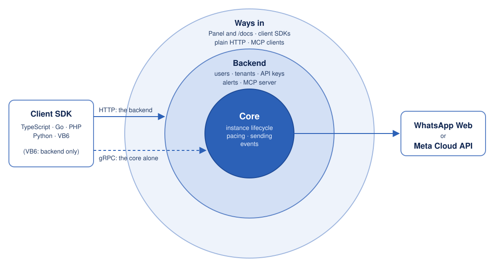
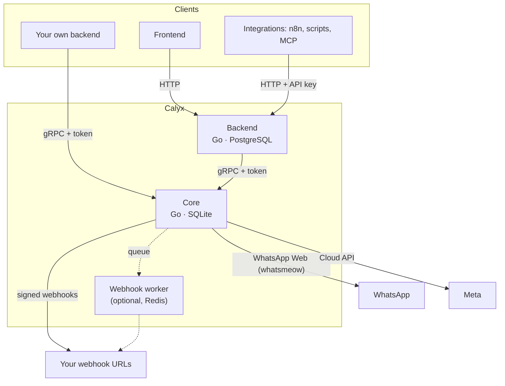

# Architecture

This page explains how Calyx is divided, what each part does, and why. For installation, see the
[README](../README.md).

## The idea in one picture

<p align="center">
  
</p>

Each ring works without the rings outside it. A core client calls the core over gRPC, with no
backend.

### The connections



## Rules between the layers

- ✅ **Dependencies point down only:** frontend → backend → core. The core never calls the
  backend.
- ✅ **Each layer works alone.** The core runs without the backend; the backend runs without the
  frontend.
- ✅ **The core knows nothing about people.** No users, no tenants. One token protects it, and it is
  meant to sit on a private network.
- ✅ **The guardrails live in the core.** Pacing is enforced where the messages leave, so no upper
  layer and no client can skip it.
- ✅ **The `.proto` files are the public contract** of the core (`calyx.core.v1`). A change to them
  is an API change.

## The core (`apps/core`)

The core keeps WhatsApp numbers ("instances") connected and sends their messages.

| What | How |
|---|---|
| Providers | `WHATSAPP_WEB` (whatsmeow, QR or pairing code) and `META_CLOUD` (official Cloud API). Both implement one `Provider` interface. |
| Types of instance | Long-lived (WhatsApp Web, always connected, receives events), send-only (WhatsApp Web, connected only to send, closed after 60 s with no work) and Meta Cloud API (no connection to keep). Details: [core README](../apps/core/README.md#types-of-instance). |
| Sending | One outbound queue ("outbox") per instance. Every message goes through it, so pacing applies to all of them. |
| Bulk jobs | Planned once, stored in SQLite, resumed after a restart. Progress and estimated end time are available. |
| Events | Signed webhooks (HMAC-SHA256) and a gRPC stream. With Redis, webhooks go through a queue with retries. |
| Storage | One SQLite file: instances, bulk jobs, and the WhatsApp session keys. |
| Proof | Race tests and random stress tests of the outbox and of the instance lifecycle. |

```
apps/core/
├── cmd/core              start and graceful shutdown
├── cmd/worker            webhook worker (Redis queue)
└── internal/
    ├── database          SQLite and its migrations
    ├── engine            Provider interface, pacing, outbox, orchestrator, bulk jobs
    ├── providers/        whatsapp (whatsmeow) and meta (Cloud API + its webhook)
    ├── events            event bus, webhook delivery, queue
    └── grpcserver        gRPC server, token check, handlers
```

## The backend (`apps/backend`)

The backend adds what the core must not have: people, tenants and alerts.

| What | How |
|---|---|
| Identity | Users with email and password (argon2id), sessions with cookies, API keys, invitations, password resets, rate limits. |
| Tenancy | An organization has an owner and clients. Each client sees only its own instances. Quotas per client. |
| Instances | Records that point to core instances, pairing over SSE, webhooks, sending. |
| Bulk jobs | The core runs them; the backend records which tenant owns each one. |
| Alerts | A watcher compares the state of the instances every 30 s and after each core event. It sends a mail when one disconnects. |
| Live state | The backend subscribes to the core events (`connection.update`). A browser follows the changes over SSE (`/api/v1/events`). |
| HTTPS | Traefik gets the certificates from Let's Encrypt. |
| Storage | PostgreSQL. No message content is stored. |

```
apps/backend/
├── cmd/backend           one binary: serve, migrate, operator commands
└── internal/
    ├── config, clock     environment and logging; the clock that every package takes
    ├── database          PostgreSQL pool, migrations, SQL queries (sqlc)
    ├── apierr            the one error type of the API
    ├── auth              passwords, sessions, API keys, invitations, resets
    ├── tenancy           organizations, clients, roles, permissions, quotas
    ├── core              gRPC client of the core
    ├── instances, bulk   instance records, pairing, sending, bulk job ownership
    ├── live              core health and the hub of change notifications
    ├── watcher, mail     state checks, the core event listener, alert mails
    ├── httpapi           Huma operations, middleware, the mail link paths, OpenAPI
    └── operator          commands for the person who runs the server
```

### Why `internal/`

In Go, the compiler does not let other modules import a package under `internal/`. The backend and
the core are programs, not libraries, so all their code is there. Only the generated gRPC code in
`packages/shared-types/go` is public, because other programs use it.

The packages are grouped by feature (auth, tenancy, instances), not by technical layer. Each
package holds its own rules, and the HTTP layer only translates requests and answers.

## The rest of the repository

```
├── apps/
│   ├── core             the core (Go)
│   ├── backend          the backend (Go)
│   └── frontend         the web UI (React)
├── packages/
│   ├── shared-types     .proto files, Go module and OpenAPI document
│   └── client-sdk       client SDKs: TypeScript, Go, PHP and Python (two packages each), VB6
├── docs/                architecture and installation options
├── docker-compose.yml   every service, grouped by profiles
└── docker-compose.dev.yml   runs the Go services from the source
```

## The client SDK contract

The rules that every client SDK follows are in
[`packages/client-sdk/CONTRACT.md`](../packages/client-sdk/CONTRACT.md).
